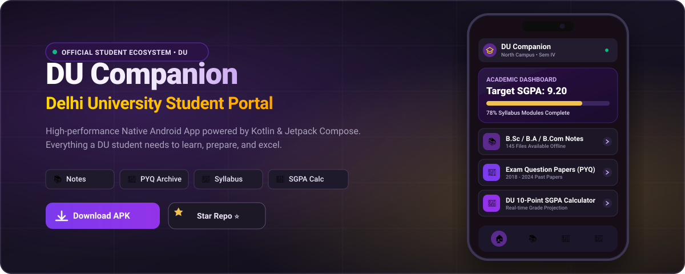
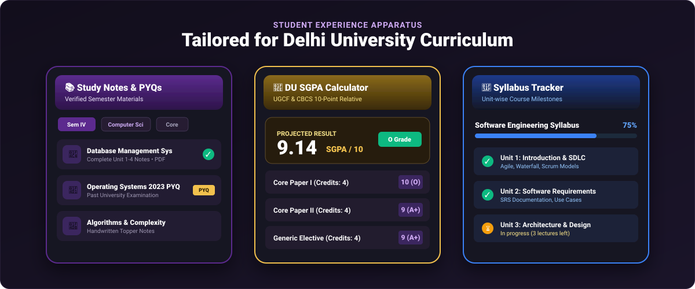

# 🎓 DU Companion (Delhi University)

### The Ultimate Android App for Delhi University Students
**Lecture Notes • Past Year Questions (PYQ) • Complete Syllabus • 10-Point SGPA Calculator**

 

 

<!-- Hero Banner Graphic (Available when assets folder is uploaded) -->

  

[📥 **Download Latest APK**](https://github.com/Devanshu-uu/DU-Companion---Delhi-University-Student-Portal/releases/latest/download/DU.Companion.apk) • [✨ **Features**](#-features) • [📲 **How to Install**](#-how-to-install-apk) • [📬 **Support & Feedback**](#-contact--support)

---

## 📱 About the App

**DU Companion** is a free Android app built exclusively for students across all colleges and campuses of the **University of Delhi**. 

Tired of digging through unorganized Telegram channels, scattered Google Drive links, and broken PDFs before exams? DU Companion brings everything you need for your semester into one fast, lightweight, and clean app.

---

## ✨ Features

<!-- UI Preview Graphic (Available when assets folder is uploaded) -->

  

| Feature | What you get |
|---|---|
| 📚 **Study Notes** | Clean, verified lecture notes for B.A., B.Sc., B.Com, and other DU undergraduate programmes. Download once and read offline. |
| 📑 **Past Year Papers (PYQs)** | Year-wise examination question papers to help you understand exam patterns and important questions. |
| 🎯 **Unit-wise Syllabus** | Detailed curriculum for your specific course and semester with unit breakdown so you know exactly what to study. |
| 🧮 **DU SGPA Calculator** | Calculate your SGPA and CGPA in seconds using DU's official 10-point relative grading system and credit scheme. |
| ⚡ **Built-in PDF Reader** | Smooth, instant PDF reading directly inside the app — no need to open external PDF apps. |
| 🔄 **Auto Updates** | Receive new updates, study materials, and bug fixes automatically inside the app. |

---

## 📲 How to Install APK

Installing the app on your phone takes less than 1 minute:

1. **Download:** Click on [**Download DU.Companion.apk**](https://github.com/Devanshu-uu/DU-Companion---Delhi-University-Student-Portal/releases/latest/download/DU.Companion.apk) (approx. 3.5 MB).
2. **Open:** Once downloaded, tap the file in your notification bar or Downloads folder.
3. **Allow Installation:** If Android asks for permission (*"Install unknown apps"*), tap **Settings** and toggle **Allow from this source**.
4. **Install & Enjoy:** Tap **Install**, open **DU Companion**, and select your course & semester!

---

## ❓ Frequently Asked Questions (FAQ)

<b>Is DU Companion free to use?</b>

 
Yes! The app is 100% free for all Delhi University students.

<b>Does it work offline?</b>

 
Yes. Once you open or download a study note or paper, it is cached on your device so you can access it anytime without internet.

<b>Why does my phone say "File might be harmful"?</b>

 
This is a standard Android warning whenever you download an APK directly from a browser instead of the Play Store. DU Companion is completely safe and free from any malware.

<b>Will it be available on Google Play Store?</b>

 
Yes! The app is being prepared for Google Play Store release soon.

---

## ⚠️ Disclaimer

> **Student Initiative Disclaimer:**  
> DU Companion is an **independent student initiative** and is **not officially affiliated with, endorsed by, or connected to the University of Delhi (du.ac.in)** or any of its colleges.  
> 
> All study materials, syllabi, and past year question papers are compiled from publicly available academic sources for personal educational reference under fair use. If you have any copyright concerns regarding any material, please contact us for immediate removal.

---

## 📬 Contact & Support

Have feedback, found a bug, or want study material for your course added?

- 📧 **Developer Email:** [devanshumohriya@gmail.com](mailto:devanshumohriya@gmail.com)
- 🐛 **Report an Issue:** [GitHub Issues](https://github.com/Devanshu-uu/DU-Companion---Delhi-University-Student-Portal/issues)
- 👨‍💻 **Developer:** [@Devanshu-uu](https://github.com/Devanshu-uu)

  Made with 💜 for Delhi University students

